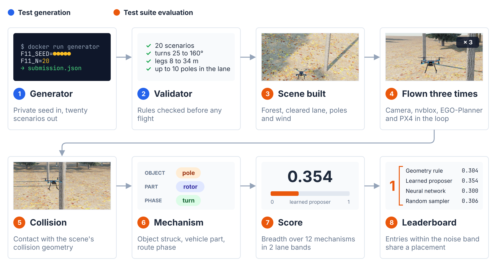
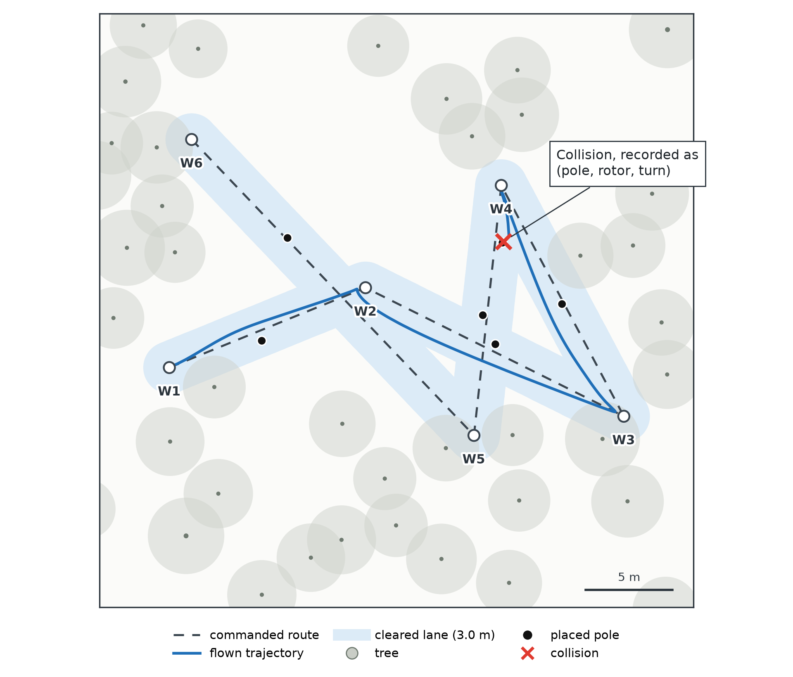
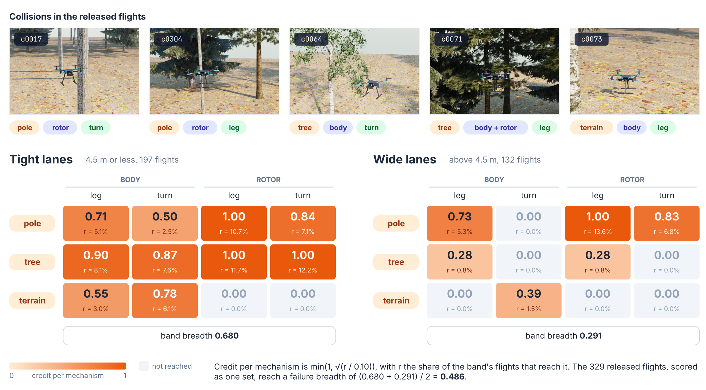

# UAV Perception Testing Track

A tool competition on test scenario generation for autonomous UAVs, part of the [ICST 2027 Challenge Competition Track](https://conf.researchr.org/track/icst-2027/icst-2027-challenge-competition-track#pagetab-c008f3db-b76a-438a-8aaa-eb62b8f7219b).

A submission is a **scenario generator**. It writes forest scenarios: a route, the width of the lane cleared along it, poles placed near the route, tree density, wind, speed and altitude. Each scenario is flown in Isaac Sim by a fixed autonomy stack. Generators are ranked by the **distinct failure mechanisms** their scenarios reach.

Track site: **https://ideals-lab.github.io/uav-testing-track-2027/**

```bash
git clone --single-branch https://github.com/IDeaLS-Lab/uav-testing-track-2027.git
cd uav-testing-track-2027
```

## Important dates

Tentative, following the ICST 2027 Challenge Competition Track schedule. Deadlines are anywhere on Earth (UTC-12).

| milestone | date |
| --- | --- |
| competition opens | 1 November 2026 |
| live scoring of submissions | from the opening to the submission deadline |
| submission deadline | 15 January 2027 |
| final re-evaluation of each team's best submission | between the deadline and the notification |
| notification to participants | 15 February 2027 |
| tool papers and competition report | 28 February 2027 |
| camera-ready | 7 March 2027 |
| presentation at ICST 2027, San Sebastián, Spain | 17 to 21 May 2027 |

## How a submission is evaluated



Each submission is evaluated as it arrives: the generator runs on a seed that is not disclosed in advance and writes twenty scenarios. `validate.py` checks them before any simulation time is spent. Each accepted scenario is flown three times, sixty flights in all, with a limit of 1320 s per flight including simulator start-up. A flight without a usable record counts as invalid for that repeat and is not re-flown.

Scores appear on the live scoreboard of the track site as soon as they are computed. A team may submit up to five times. After the deadline each team's best-scoring submission is evaluated again on a new undisclosed seed; that evaluation decides the final ranking, so a score that was high by chance on the live board does not carry over.

The system under test is the same for every submission, so a difference in score reflects a difference between generators:

| layer | configuration |
| --- | --- |
| simulator | Isaac Sim 6.0.1 with the Pegasus Simulator extension, procedural forest scenes |
| perception | simulated RGB-D camera with RealSense D455 intrinsics (640 x 480, 87° field of view), nvblox volumetric mapping |
| planner | EGO-Planner |
| autopilot | PX4 in software-in-the-loop, Holybro X500 airframe with a swept radius of 0.444 m |
| middleware | ROS 2 Jazzy |
| adjudication | physics contact against the scene's collision geometry |

## What counts as a failure



*Flight c0017 from the training data. After waypoint W4 a rotor strikes a placed pole, which is recorded as the mechanism (pole, rotor, turn).*

A failure is a **collision** between the vehicle and the scene's collision geometry: a placed pole, a tree or the terrain. The collision ends the flight and is recorded as a **mechanism**: the object struck (pole, tree, terrain), the vehicle part (body, rotor) and the route phase (turn if the strike is within 3.0 m of a waypoint, leg otherwise). There are twelve mechanisms. A mechanism records what was struck, with which part and in which phase; it does not record whether the obstacle was missing from the map. Telling perception failures from planning failures apart is one of the questions the track studies.

Contacts within 0.5 s of the terminating contact belong to the same strike, so one flight can reach more than one mechanism. Passing close to an obstacle without touching it is not a failure. A collision without readable contact evidence counts as a crash but reaches no mechanism.

## Scoring



The rank key is **failure breadth** (`mech_rate`). Coverage of the twelve mechanisms is computed separately for tight lanes (4.5 m and below) and for wide lanes, then the two are averaged:

```
breadth = mean over the two bands of ( mean over the 12 mechanisms of min(1, sqrt(r / 0.10)) )
```

where `r` is the share of that band's flights that reach the mechanism. An empty band scores zero, so twenty scenarios at one lane width give away half the score. Credit per mechanism saturates, so reaching a new mechanism is worth more than repeating one. Crash count is not ranked, because crash rate and failure breadth can order generators differently: among the sample tools, the random sampler has the lowest crash rate (0.250) and the second-highest breadth (0.306).

Eight further diagnostics, among them crash rate, severity, diversity and validity, are shown on the site with every score. There is no weighted total.

Entries are ordered by failure breadth averaged over the three evaluations. An entry within the noise band of a placement's leader shares that placement and ties are not broken. The band is the half-width of the 95% Welch t interval for the difference of two mean breadths; between the sample tools it ranges from 0.094 to 0.146 and the board uses 0.146.

The scorer and the leaderboard rule are in `scoring/`. The per-flight records are released with the results, so the ranking can be recomputed independently.

## Scoreboard

Four sample tools, each evaluated three times at the full budget, set the reference level a submission is compared with; the two examples in `examples/` are the starting points to copy:

| place | tool | submitted by | mech_rate | three evaluations | crash | validity |
| --- | --- | --- | --- | --- | --- | --- |
| 1 | geometry rule | sample tool | 0.304 | 0.354, 0.276, 0.281 | 0.500 | 1.000 |
| 1 | learned proposer | sample tool | 0.354 | 0.373, 0.340, 0.349 | 0.600 | 1.000 |
| 1 | neural network | sample tool | 0.300 | 0.323, 0.346, 0.233 | 0.499 | 0.933 |
| 1 | random sampler | sample tool | 0.306 | 0.292, 0.375, 0.250 | 0.250 | 1.000 |

All four lie within the noise band of the leader and share the first placement. To be placed ahead of them, a submission needs a breadth above 0.500.

## Building a generator

A generator is a container image. It reads `F11_SEED` and `F11_N` from the environment, writes the scenarios to `/out/submission.json` and exits 0. At evaluation it has no network, a read-only filesystem with 64 MB of writable `/tmp`, 512 MB of memory, one CPU, no root and 600 s. **The same seed must produce the same bytes**, so every random draw is seeded from `F11_SEED` and the clock, the filesystem and the network are not read.

No GPU or Isaac Sim is needed to take part. A generator is built and run with Docker; `validate.py`, `preflight.py` and `estimate.py` use only the Python standard library.

### Quick start

```bash
cd starter_kit
docker build -t my-generator .

mkdir -p out
docker run --rm --network none --read-only --tmpfs /tmp:rw,size=64m \
  --cap-drop ALL --security-opt no-new-privileges --memory 512m --cpus 1 \
  --user $(id -u):$(id -g) \
  -e F11_SEED=7 -e F11_N=20 -v $PWD/out:/out my-generator

python3 validate.py out/submission.json     # will it be accepted?
python3 preflight.py out/submission.json    # what can be measured before flying
python3 estimate.py out/submission.json     # rough estimate of the rank key (off by 0.07 on average)
```

These are the flags used at evaluation. To write your own generator, copy `starter_kit/` and replace `generate.py`:

```python
import json, os, random

seed = int(os.environ["F11_SEED"])
n    = int(os.environ["F11_N"])
rng  = random.Random(seed)          # the only source of randomness

def my_scenario(rng, i):
    y = round(rng.uniform(-10.0, 10.0), 2)
    return {
        "id": f"s{i:03d}", "seed": rng.randint(1, 100000),
        "area": 20.0, "voxel": 0.10,
        "corridor": rng.choice([2.0, 3.0, 4.5, 6.0, 9.0, 12.0]),
        "density": round(rng.uniform(0.012, 0.120), 4),
        "wind": round(rng.uniform(0.0, 8.0), 1),
        "ego_max_vel": round(rng.uniform(1.2, 3.5), 2),
        "alt": round(rng.uniform(0.5, 4.0), 3),
        "patrol": [[-12.0, y], [12.0, y]],
        "obstacle": {"type": "poles", "xy": [], "radius": 0.06, "height": 3.0},
    }

scenarios = [my_scenario(rng, i) for i in range(n)]

os.makedirs("/out", exist_ok=True)
with open("/out/submission.json", "w") as f:
    json.dump({"submission": "my-generator", "scenarios": scenarios}, f, indent=1, sort_keys=True)
```

This example passes `validate.py`, but its straight routes have no turns and no poles, so it reaches few mechanisms. `starter_kit/generate.py` builds routes with turns and places poles in the lane.

A scenario looks like this. `seed` selects the procedural forest, `corridor` is the width of the lane cleared along the route and `patrol` is the commanded route:

```json
{
  "id": "s000", "seed": 41835,
  "area": 20.0, "voxel": 0.10, "corridor": 4.5,
  "density": 0.0364, "wind": 1.7, "ego_max_vel": 1.56, "alt": 2.086,
  "patrol": [[8.44, 10.92], [11.65, -5.22]],
  "obstacle": {"type": "poles", "xy": [[9.29, 6.3]], "radius": 0.06, "height": 3.0}
}
```

### Examples

- `examples/random_baseline/` is the smallest generator that passes the validator.
- `examples/svm_generator/` fits a classifier on the training data (`pip install -r requirements.txt`, then `python3 train.py ../../data/train/manifest.jsonl -o model.json`) and bakes it into the image as JSON.

Each example uses only one lane band and so loses half the rank key.

## Rules

| rule | value |
| --- | --- |
| submissions per team | at most 5 before the deadline |
| software | Isaac Sim 6.0.1 and the stack above, unchanged from the opening to the final evaluation |
| scenarios per submission | exactly 20, at least 5 distinct recipes ignoring the forest seed |
| waypoints | 2 to 6 |
| turn at each intermediate waypoint | 25 to 160° |
| leg length | 8.0 to 34.0 m |
| margin from the field edge | 3.0 m |
| poles | at most 10, at least 3.0 m from any waypoint, 1.5 m apart, inside the lane |
| corridor | 2.0 to 12.0 m |
| density | 0.012 to 0.120 |
| wind | 0.0 to 8.0 m/s |
| ego_max_vel | 1.2 to 3.5 m/s |
| alt | 0.5 to 4.0 m |
| area | 10.0 to 40.0 m |
| voxel | 0.05 to 0.20 m |
| pole_radius, pole_height | 0.02 to 0.10 m, 1.0 to 5.0 m |

The turn limit is the most common reason for rejection; check it on the rounded coordinates. A blocked lane is still admissible, because the planner can detour through the forest. Training beforehand is allowed, provided everything the generator needs is inside the image.

## Data

`data/train/manifest.jsonl` holds 357 flight records: the scenario flown, the route, the obstacles, the outcome and the mechanisms reached. `data/train/splits.json` gives the train and validation split. The records serve training and `estimate.py`, not evaluation: every submission is scored on new flights of its own scenarios. They reach 10 of the 12 mechanisms; no released flight has a rotor striking the terrain.

The full collection with depth images, maps and autopilot logs (17.8 GB) is on Hugging Face at [`merabro/uav-perception-testing-track-2027`](https://huggingface.co/datasets/merabro/uav-perception-testing-track-2027). It is not needed to write a generator. Access is granted on request through the form on the dataset page.

## Submitting

1. Build the generator from `starter_kit/` and check it with `validate.py`.
2. Run the container twice on one seed and confirm that `md5sum out/submission.json` matches.
3. Open a pull request that adds `submissions/<team-name>/` with the Dockerfile, `generate.py`, any files the image needs and a `README.md` of about one page describing the approach. Every evaluated submission counts toward the team's limit.

Submissions close on 15 January 2027, anywhere on Earth. Participating teams may be invited to submit a tool paper of 2 to 4 pages, including references, in the ICST format. Results are presented at ICST 2027.

Like the UAV testing tracks held at SBFT and ICST since 2024 ([SBFT 2024](https://doi.org/10.1145/3643659.3643931), [SBFT 2025](https://doi.org/10.1109/SBFT66712.2025.00007), [ICST 2025](https://doi.org/10.1109/ICST62969.2025.10988922), [SBFT 2026](https://doi.org/10.1145/3786155.3795696), [ICST 2026](https://doi.org/10.1109/ICST69053.2026.00073)), this track asks participants to submit test generators. It keeps that task and changes the system under test and the failure oracle.

<details>
<summary>Differences from the ICST 2026 UAV testing track</summary>

| | ICST 2026 UAV track | this track |
| --- | --- | --- |
| system under test | PX4 with obstacle avoidance, executed through Aerialist | fixed closed-loop stack: RGB-D mapping, planner, PX4 |
| test input | up to three box obstacles added to a given mission | twenty generated forest scenarios |
| failure | crash, or minimum distance to an obstacle below 1.5 m | collision with collision geometry; proximity alone is not a failure |
| budget | 100 simulations per case study, 500 s each | 60 flights per submission, 1320 s each |
| ranking | failure score together with test diversity | breadth of failure mechanisms reached |

</details>

## Awards

The teams in the first three places of the final ranking receive prizes.

## Organizers and contact

| organizer | email |
| --- | --- |
| Prakash Aryan (AI4I and University of Bern) | prakash.aryan@ai4i.it |
| Claudia Ceci (AI4I) | claudia.ceci@ai4i.it |
| Roberto Riccio (AI4I) | roberto.riccio@ai4i.it |
| Syed Shaihan (AI4I) | syed.shaihan@ai4i.it |
| Mohammad Sabouri (AI4I) | mohammad.sabouri@ai4i.it |
| Yahya Momtaz (AI4I) | yahya.momtaz@ai4i.it |
| Sebastiano Panichella (AI4I) | sebastiano.panichella@ai4i.it |

The organizers use the same stack in their own research and maintain it across editions; updates are made between editions ([issue #1](https://github.com/IDeaLS-Lab/uav-testing-track-2027/issues/1)). The data, the scorer and the results of each edition stay archived in this repository.

Open an issue for questions about the rules or the starter kit; anything that would reveal an approach should go to the organizers by email.

## License

Code: MIT ([`LICENSE`](LICENSE)). Flight records in `data/`: CC BY 4.0 ([`data/LICENSE`](data/LICENSE)).
